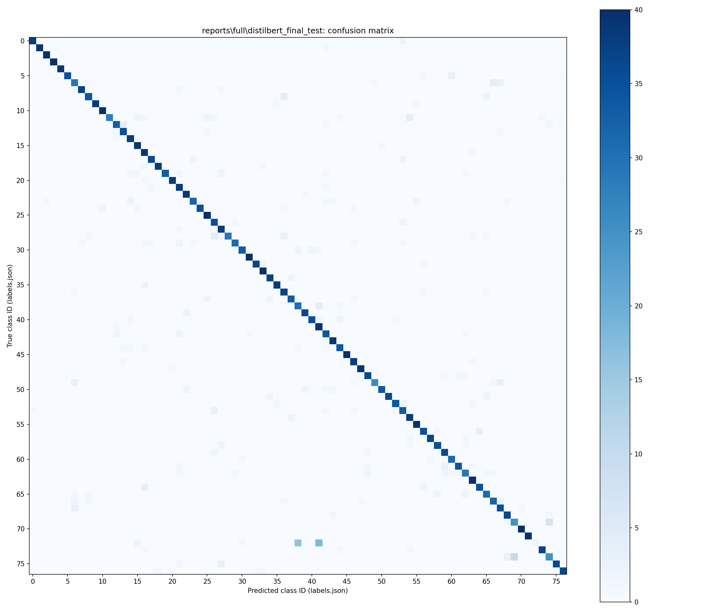

# Support Ticket Classification with DistilBERT

A manageable Python project for comparing a TF-IDF + logistic regression classifier with a fine-tuned DistilBERT model on banking support intents. The purpose is to demonstrate the whole experiment lifecycle, including honest negative results.

**Current status:** smoke and full training completed, including actual pretrained DistilBERT fine-tuning on a local NVIDIA GPU. On the common filtered test set of **3,020 queries across 77 intents**, DistilBERT achieved **89.60% accuracy and 0.8907 macro-F1**, compared with **86.79% accuracy and 0.8664 macro-F1** for TF-IDF + logistic regression. **Local real-model API serving is verified:** six tests passed without skips, and both trained backends passed 11 HTTP checks each. This is a locally served application, not a public or production deployment.

## Measured results

These are **full-training final test results**, reviewed from saved local reports on 2026-10-19. Smoke-mode and invented-fixture scores are excluded.

| Model | Test accuracy | Test macro-F1 | Correct / total | Errors |
|---|---:|---:|---:|---:|
| TF-IDF + logistic regression | 86.79% | 0.8664 | 2,621 / 3,020 | 399 |
| Fine-tuned DistilBERT | **89.60%** | **0.8907** | **2,706 / 3,020** | **314** |

DistilBERT improved accuracy by **2.81 percentage points** and macro-F1 by **0.0243**, making **85 fewer errors**. This is one seeded experiment on a filtered population, not a statistical significance claim or a direct comparison with published unfiltered BANKING77 benchmarks.

### Experiments and checkpoint selection

| Model / setting | Validation accuracy | Validation macro-F1 |
|---|---:|---:|
| Logistic regression, C=1 | 82.82% | 0.8074 |
| Logistic regression, C=4 — selected | 86.57% | 0.8551 |
| DistilBERT, LR 2e-5, epoch 3 | 79.67% | 0.7304 |
| DistilBERT, LR 5e-5, epoch 3 — selected | **90.06%** | **0.8872** |

Both DistilBERT learning-rate runs fine-tuned the encoder and classification head for three epochs, completing **1,368 optimizer steps per run**, with seed 42. Validation macro-F1 selected each model family's checkpoint; the selected models were then evaluated on the shared held-out test set. Saved reports include per-class precision/recall/F1, confusion matrices, and concrete misclassifications. Review checks confirmed that the final confusion matrices reproduce reported accuracy and error counts, saved duplicate-group IDs do not cross partitions, and label mappings agree.

The supporting evidence is published: [final comparison](reports/full/final_comparison.json), [baseline experiments](reports/full/baseline_experiments.json), [DistilBERT experiments](reports/full/transformer_experiments.json), [data audit](reports/full/data_audit.json), and [per-class metrics and confusion matrices](reports/README.md). The [experiment report](reports/EXPERIMENT_REPORT.md), [resume bullets](reports/RESUME_BULLETS.md), and [interview guide](docs/INTERVIEW_GUIDE.md) reflect these completed runs and their limitations.



The [JSON matrix](reports/full/distilbert_final_test/confusion_matrix.json) maps the class IDs in the plot to canonical intent names.

## Dataset and attribution

Use [BANKING77 from PolyAI](https://github.com/PolyAI-LDN/task-specific-datasets), introduced by Casanueva, Temcinas, Gerz, Henderson, and Vulić, *Efficient Intent Detection with Dual Sentence Encoders*, 2020 ([paper](https://arxiv.org/abs/2003.04807)). The upstream repository lists 10,003 train and 3,080 test customer queries, across 77 fine-grained English online-banking intents. This is customer-intent routing, a proxy for ticket classification, not a collection of complete support threads.

The actual upstream CSV URLs were reachable through web inspection on 2026-10-19: [train](https://raw.githubusercontent.com/PolyAI-LDN/task-specific-datasets/master/banking_data/train.csv) and [test](https://raw.githubusercontent.com/PolyAI-LDN/task-specific-datasets/master/banking_data/test.csv). The header is `text,category`; text fields are quoted where necessary. The [Hugging Face metadata](https://huggingface.co/datasets/PolyAI/banking77/blob/main/dataset_infos.json) independently describes the 77 labels and official split sizes. The completed local preparation run verified these source sizes and saved their revision and SHA-256 hashes.

The upstream [LICENSE](https://github.com/PolyAI-LDN/task-specific-datasets/blob/master/LICENSE) is **Creative Commons Attribution 4.0 International**. Preserve attribution, link the license, indicate modifications (this project filters overlap/conflicts and creates validation partitions), and do not imply endorsement. See [license terms](https://creativecommons.org/licenses/by/4.0/). No paid service is required. Dataset license applies to the data; it does not automatically license pretrained weights or your code. The selected [DistilBERT model card](https://huggingface.co/distilbert/distilbert-base-uncased) declares Apache-2.0. Keep the model notices with redistributed artifacts.

Labels are categorical intents such as `card_arrival` (a card has not arrived or delivery tracking), `cancel_transfer` (cancel a transfer), `card_not_working` (a card fails to work), and `pending_transfer` (a transfer remains pending). The machine-readable glossary for **all 77 labels** is generated from the source categories in `data/<mode>/labels.json`; their human-readable meanings are the underscore-separated category names. Read the dataset card for the complete source list. These are routing targets, not sentiment, urgency, ticket priority, or banking advice. See `docs/DATASET.md` for finer distinctions and limits.

## Layout

```text
configs/                 full and smoke experiment settings
ticketnlp/data.py        immutable source download, schema checks, leakage audit, splits
ticketnlp/baseline.py    training-only TF-IDF and logistic regression
ticketnlp/transformer.py PyTorch fine-tuning and batched prediction
ticketnlp/evaluation.py  metrics, confusion plots, misclassifications
ticketnlp/inference.py   consistent artifact loading and prediction
ticketnlp/api.py         small FastAPI service
ticketnlp/run.py         explicit experiment stages
tests/                  leakage, mapping, preprocessing and API checks
reports/                logs and measured results (no checkpoints)
data/ artifacts/        generated locally, ignored by Git
```

## Setup (Windows PowerShell)

Python 3.10–3.12 is recommended for broad wheel availability. An isolated environment avoids changing your existing installation. Completed training used **Python 3.10.11, PyTorch 2.11.0+cu128, and an NVIDIA GeForce RTX 3050 6GB Laptop GPU**. The inspected host has 12 logical CPUs and approximately 15.7 GiB RAM. The separate global Python installation was CPU-only; activate the project environment to use CUDA.

```powershell
py -3.10 -m venv .venv
.\.venv\Scripts\Activate.ps1
python -m pip install --upgrade pip
# CUDA wheels for this NVIDIA machine; use the current official selector if needed:
python -m pip install torch --index-url https://download.pytorch.org/whl/cu128
python -m pip install -e '.[test]'
python -c "import torch; print(torch.__version__, torch.cuda.is_available())"
python -m pytest -q
```

For CPU, install PyTorch using the [official installation selector](https://pytorch.org/get-started/locally/) before the editable install. Training automatically uses CUDA when available. The completed full GPU run used batch size 8 with two accumulation steps, maximum 96 tokens, FP32, and no DataLoader workers. The CPU default is batch size 4. If GPU memory runs out on another machine, reduce `batch_size_cuda` to 4 or 2 before preparation and increase accumulation to preserve the effective batch. Do not change settings after seeing test results.

Dependency ranges are in `pyproject.toml`. The [verification environment snapshot](reports/verification/requirements-environment.txt) records the installed versions used for the current tests and real-model serving checks, including CUDA PyTorch; it was captured after training, not reconstructed as an exact training lockfile. `reports/local_checks/environment.txt` is the historical CPU-only build environment. For future training runs, capture `python -m pip freeze > requirements-lock.txt` at run time. CUDA wheel installation still requires the appropriate PyTorch package index.

## Smoke mode: functionality, not model quality

```powershell
python -m ticketnlp.run prepare --config configs/smoke.json
python -m ticketnlp.run baseline --config configs/smoke.json
python -m ticketnlp.run transformer --config configs/smoke.json
python -m ticketnlp.run final --config configs/smoke.json
```

Smoke uses all 77 labels but only up to 3 train and 2 validation/test examples per class, one learning rate, one epoch, and at most **6 optimizer steps** for DistilBERT. It still downloads the real pretrained weights and audits the entire dataset first. Expect poor, noisy predictions: this verifies wiring rather than learning quality. Smoke and full data/artifacts/reports have distinct directories. Smoke models identify their mode in API responses.

Smoke mode completed successfully, but its model scores are not portfolio performance results; use the full-training table above.

## Full experiment

```powershell
python -m ticketnlp.run prepare --config configs/full.json
python -m ticketnlp.run baseline --config configs/full.json
python -m ticketnlp.run transformer --config configs/full.json
# Review validation reports before proceeding. Settings are now frozen.
python -m ticketnlp.run final --config configs/full.json
```

Or run `powershell -ExecutionPolicy Bypass -File scripts/train_gpu.ps1` from the project folder after setup. The commands use free local compute only. CPU full training may take substantially longer; no duration estimate has been measured. For a free GPU notebook, see `docs/GPU_RUN.md`.

Preparation resolves the upstream Git commit once, downloads CSV/license files at that revision, checks schema/size/labels, and records SHA-256 hashes. Keep `data/raw/revision.txt` and `reports/<mode>/data_audit.json` to reproduce the exact data revision. Never commit raw datasets or weights.

### Leakage control and official split changes

NFKC normalization, case folding, punctuation removal, and whitespace normalization identify exact duplicates. A **stateless** hashed character 3–5 gram cosine threshold of 0.90 identifies close lexical variants. All detected duplicate pairs form connected components (including transitive links). This audit sees held-out text for contamination checks only; it learns no IDF or classifier features from held-out data. It does not guarantee detection of semantic paraphrases; hashing collisions and the threshold can over/under-group sentences.

Preserve the official test partition except for conflicting-label components, which are quarantined from all partitions. Remove official training examples whose component touches test. Split remaining training data with seeded five-fold stratified group splitting; one fold (~20%) becomes validation. Whole groups stay together, even across different intent labels. Fail if a class disappears from any partition. Exact source, removal counts, components, and per-class counts are saved in the audit. Therefore results are **not directly comparable** with published unfiltered BANKING77 benchmarks. Test-internal repetitions can remain and overweight repeated queries; document their audit counts when reporting results.

Both models consume the same saved row IDs, labels, and partitions. Only training fits the TF-IDF vocabulary/IDF and classifier. DistilBERT uses its pretrained tokenizer and only training examples update weights. Neither evaluation split is used to fit preprocessing. Fixed seed 42 controls split generation, initial classification head, and shuffling; GPU/library differences can still change numerical results.

The completed audit used source revision `57ec275d8078af65b7731c2a98be812d844a6d6b`. It found **60 normalized duplicate rows**, **1,962 similarity pairs**, and **50 conflicting-label components**. Removing official training rows whose component touches test excluded 839 rows; quarantining conflicting-label components further changed both populations. The resulting shared partitions were:

| Partition | Examples |
|---|---:|
| Training | 7,296 |
| Validation | 1,810 |
| Test | 3,020 |

The review verified disjoint saved component IDs across these partitions; it did not recompute the full pairwise similarity audit. The lexical threshold does not guarantee removal of all semantic paraphrases.

### Selection and final results

Baseline experiments compare `C=1` and `C=4`: a small regularization sweep for sparse features. DistilBERT experiments compare learning rates `2e-5` and `5e-5` over three epochs, with AdamW, weight decay 0.01, gradient clipping 1.0, and a short warmup/decay schedule. Select each family's checkpoint on **validation macro-F1**, with the first candidate winning ties. No seed sweep or statistical significance claim is implied.

The `final` stage loads both selected models and evaluates the common held-out test set. It refuses to overwrite a completed final comparison. Do not delete this guard to tune against test. A new experiment after inspecting test requires a genuinely fresh holdout for an unbiased estimate.

Reports contain accuracy, macro-F1, per-class precision/recall/F1/support, raw confusion matrices and PNG plots. Experiment JSON files include configurations, seeds, validation metrics, and (for DistilBERT) training loss, epoch, device, source revision and elapsed time. Errors retain local ticket text and scores for manual review; avoid publishing potentially sensitive real production tickets. `final_comparison.json` states the observed macro-F1 difference. A positive delta means DistilBERT beats the baseline on that run's macro-F1; it does not establish statistical significance.

## API

After training, launch a single process (each worker would load its own model):

```powershell
$env:MODEL_DIR='artifacts/full'
$env:MODEL_BACKEND='distilbert' # or baseline
python -m uvicorn ticketnlp.api:app --host 127.0.0.1 --port 8000
Invoke-RestMethod -Method Post -Uri http://127.0.0.1:8000/predict -ContentType 'application/json' -Body '{"text":"My card has not arrived yet"}'
```

The response schema is `{label, score, model, mode, truncated}`. The score is the predicted class's softmax probability (DistilBERT) or logistic regression probability, **not calibrated confidence**. `/docs` provides interactive API documentation; `/health` reports ready only after startup loads artifacts. Missing artifacts fail startup, and there is no silent model fallback. Load only trusted local joblib files.

The verified local DistilBERT server returned this response to the invented demonstration input `My card has not arrived yet.`:

```json
{"label":"card_arrival","score":0.844367265701294,"model":"distilbert","mode":"full","truncated":false}
```

This single example verifies inference behavior, not classification accuracy or calibrated confidence. See the [real-model HTTP verification summary](reports/inference_verification/summary.json) and [per-backend evidence](reports/README.md).

Requests must contain a string with 1–4,000 characters and at least one non-whitespace character; invalid input returns HTTP 422. Whitespace is collapsed in training and serving. DistilBERT retains only the first `max_length` WordPiece tokens including special tokens (96 full / 64 smoke), and reports `truncated=true` when text exceeds that limit. Baseline uses all accepted input. Information near the end of a long ticket may be lost. The development API has no authentication, rate limits or production monitoring; keep it local.

### Reproduce serving verification

With trained artifacts in `artifacts/full`, run:

```powershell
python -m pytest -q -o faulthandler_timeout=30
python -m scripts.verify_inference
python -m scripts.verify_reports
```

The inference script loads existing trusted local checkpoints, starts temporary servers on `127.0.0.1`, verifies both model backends over actual HTTP, records reports, and stops the servers. It does not download weights or rerun model-quality evaluation. It checks readiness, OpenAPI, prediction schema, repeated requests, whitespace consistency, five invalid input cases, and acceptance of 4,000 characters with expected token truncation.

The earlier test stall was traced to Windows asyncio creating a loopback socket (`socketpair`) before API startup in the restricted execution environment. The same suite passed with local socket access permitted; no application-code fix or dependency replacement was needed. Allow local loopback sockets when running the tests or server. The passing run has one upstream Starlette/httpx deprecation warning; see [test output](reports/verification/pytest.txt) and [JUnit evidence](reports/verification/pytest.xml).

## Limits and next steps

English banking domain only, closed-set single-label output, no unknown/abstention class, no calibrated thresholds, and no conversation context. Related intents and short ambiguous messages remain difficult, even though DistilBERT improves overall performance.

Concrete findings from the saved test errors:

- **Virtual-card troubleshooting is a major weakness.** Only 23 training and 7 validation examples remain for `virtual_card_not_working`. DistilBERT recognizes 2 of 39 test examples (5.13% recall; F1 0.0976), compared with 14 of 39 for the baseline (F1 0.5283). DistilBERT sends 18 to `getting_virtual_card` and 16 to `get_disposable_virtual_card`. Low training coverage is a plausible contributor, not a proven cause.
- **Related intent labels are confused.** DistilBERT predicts `verify_my_identity` for 10 `why_verify_identity` queries and makes the reverse error 7 times. Card-arrival queries are sometimes classified as delivery-estimate requests. Short messages may not provide enough context to distinguish these labels.
- **High scores can still be wrong.** A query about the exchange rate applied to a transaction (`test-156`) receives the general `exchange_rate` label instead of `card_payment_wrong_exchange_rate`, with score approximately 0.918. This illustrates a mistake with a high score; it does not replace a calibration study.

Current verification records **6 tests passed, no skips**, and **22 HTTP checks across the two trained backends**. Ten saved metric reports were independently checked against their confusion matrices, including all 77 classes' precision, recall, F1 and support. The historical `reports/local_checks/` files are retained for provenance and are superseded by [current verification](reports/README.md); their invented-fixture metrics are not dataset results.

Potential next steps are calibration, unknown-intent handling, seed variability and latency/concurrency measurements. Public deployment and production readiness have not been established. Preserve the current final test results. Additional model selection should use validation; any unbiased new claim motivated by inspected test errors needs a fresh holdout.

Implementation references: [Hugging Face sequence classification](https://huggingface.co/docs/transformers/tasks/sequence_classification), [DistilBERT](https://huggingface.co/docs/transformers/model_doc/distilbert), [PyTorch reproducibility](https://docs.pytorch.org/docs/stable/notes/randomness.html), [scikit-learn group splitting](https://scikit-learn.org/stable/modules/generated/sklearn.model_selection.StratifiedGroupKFold.html), and [FastAPI lifespan](https://fastapi.tiangolo.com/advanced/events/).
