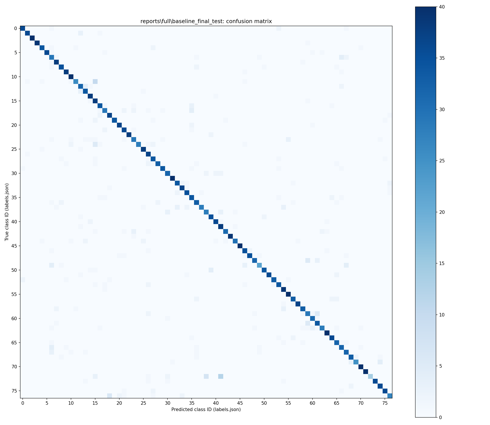

# Experiment and error-analysis report

## Completed work

Full BANKING77 preparation, baseline training, DistilBERT fine-tuning, validation selection and final test evaluation completed on a local NVIDIA RTX 3050 6GB Laptop GPU. Training used Python 3.10.11, PyTorch 2.11.0+cu128, seed 42, and the configuration in [full/config.json](full/config.json). Smoke mode also completed; its six-step Transformer run is a functionality check, not a model-quality result.

Current verification: **6 tests passed, none skipped**, plus **11 real HTTP inference checks per backend** for the saved baseline and DistilBERT. Serving was verified on localhost only. No public deployment, production readiness, throughput benchmark or calibration study is claimed.

## Dataset and partitions

BANKING77 by PolyAI / Casanueva et al. (2020), [source](https://github.com/PolyAI-LDN/task-specific-datasets), is licensed under [CC BY 4.0](https://creativecommons.org/licenses/by/4.0/). It contains short English banking queries with 77 single-label intents, rather than full support threads. This project modifies the source population through filtering and validation splitting.

The original files contain 10,003 training and 3,080 test rows. Source revision: `57ec275d8078af65b7731c2a98be812d844a6d6b`. See [data audit](full/data_audit.json) for SHA-256 hashes and all per-class counts; [audit summary](full/data_audit_summary.json) provides compact totals.

The lexical duplicate audit found 60 normalized duplicate rows and 1,962 similarity pairs at cosine threshold 0.90, forming 11,556 components. It removed 839 official training rows whose component touched test, then quarantined 50 conflicting-label components. The retained partitions are **7,296 train / 1,810 validation / 3,020 test**. A further 58 training rows and 60 test rows were excluded by conflict filtering after overlap removal. Saved duplicate-group IDs are disjoint across all partitions. Semantic paraphrases may remain; test-internal repetitions can remain. These results are not directly comparable with published unfiltered official-split benchmarks.

## Validation experiments

TF-IDF uses unigrams/bigrams, sublinear TF, up to 50,000 features, and training-only vocabulary/IDF. Logistic regression compares regularization settings. DistilBERT fine-tunes the encoder and 77-way classification head with AdamW, weight decay 0.01, maximum length 96, FP32, GPU batch 8, accumulation 2, gradient clipping 1.0 and a short warmup/decay schedule. Both learning rates used the same seed and partitions. The first candidate wins ties.

| Model / setting | Epoch | Validation accuracy | Validation macro-F1 |
|---|---:|---:|---:|
| Logistic regression C=1 | - | 82.82% | 0.8074 |
| Logistic regression C=4 | - | 86.57% | 0.8551 |
| DistilBERT LR 2e-5 | 1 | 59.01% | 0.4965 |
| DistilBERT LR 2e-5 | 2 | 74.92% | 0.6735 |
| DistilBERT LR 2e-5 | 3 | 79.67% | 0.7304 |
| DistilBERT LR 5e-5 | 1 | 77.40% | 0.7040 |
| DistilBERT LR 5e-5 | 2 | 88.01% | 0.8621 |
| DistilBERT LR 5e-5 | 3 | 90.06% | 0.8872 |

Validation macro-F1 selected **C=4** and **LR 5e-5, epoch 3**. Both Transformer runs completed 1,368 optimizer steps. The logs record elapsed time through the final validation of approximately 136.52 seconds and 146.02 seconds respectively; these are the loop's logged intervals, not end-to-end setup/training benchmarks.

Full machine-readable evidence: [baseline experiments](full/baseline_experiments.json), [Transformer experiments](full/transformer_experiments.json), [run log](full/run.log), [training hardware](full/hardware.json). The pretrained DistilBERT revision is `12040accade4e8a0f71eabdb258fecc2e7e948be`.

## Final test results

| Selected model | Accuracy | Macro-F1 | Correct / total | Errors |
|---|---:|---:|---:|---:|
| TF-IDF + logistic regression | 86.7881% | 0.866395 | 2,621 / 3,020 | 399 |
| DistilBERT | 89.6026% | 0.890706 | 2,706 / 3,020 | 314 |

DistilBERT improves macro-F1 by **0.024311**, accuracy by **2.81 percentage points**, and makes **85 fewer errors**. This is one seeded experiment; no statistical significance claim is made. Validation is exploratory selection evidence, while this table is the saved final held-out comparison. No training or final-test inference was rerun when preparing this publication.

See [final comparison](full/final_comparison.json), [baseline per-class metrics](full/baseline_final_test/metrics.json), and [DistilBERT per-class metrics](full/distilbert_final_test/metrics.json). Arithmetic was independently checked against all 10 saved confusion matrices, including every class's precision, recall, F1 and support; see [integrity verification](verification/report_integrity.json).

The JSON matrices beside these plots contain the class-ID-to-label mappings.

## Observed errors and limitations

### Virtual-card troubleshooting

`virtual_card_not_working` has only **23 training / 7 validation / 39 test** examples after filtering. DistilBERT recognizes **2/39** test examples (recall 5.13%, F1 0.097561); the baseline recognizes **14/39** (recall 35.90%, F1 0.528302). DistilBERT misroutes 18 to `getting_virtual_card` and 16 to `get_disposable_virtual_card`. Lower training coverage is a plausible contributor, not a demonstrated causal explanation.

In `test-2522`, a broken disposable virtual card is classified as a request to obtain one by both models. In `test-2521`, DistilBERT likewise treats a virtual card that does not work as requesting a disposable card. This suggests confusion between product terms and the action being requested. The overall Transformer improvement does not apply to every class.

### Related intents and missing context

DistilBERT maps 10 `why_verify_identity` examples to `verify_my_identity`, and 7 in the reverse direction. It also maps 4 `card_arrival` examples to `card_delivery_estimate`. For example, `test-5` asks when the card will arrive, receiving the estimate label despite the source arrival label. `test-0`, about locating a card, is labeled arrival by the dataset but predicted lost/stolen by DistilBERT and card linking by the baseline. These brief messages leave room for ambiguity.

### Incorrect predictions with high scores

In `test-156`, the query asks about an exchange rate applied to a transaction. DistilBERT predicts general `exchange_rate` instead of `card_payment_wrong_exchange_rate`, with score about 0.918. In `test-173`, a vague fee question receives `card_payment_fee_charged` rather than `extra_charge_on_statement`, with score about 0.927. Model probabilities are not correctness guarantees; this review does not measure calibration.

The review inspected concrete errors and aggregate confusion counts, rather than treating every confusion as proof of one linguistic cause. Text-bearing `errors.json` files remain local; published [baseline](full/baseline_final_test/error_summary.json) and [DistilBERT](full/distilbert_final_test/error_summary.json) summaries expose counts without redistributing the full dataset.

## Inference and test verification

The diagnostic trace located the earlier stall inside Windows asyncio `socketpair()` during event-loop startup, before API lifespan or model loading. A minimal FastAPI client reproduced it in the restricted execution environment. Running the same suite with loopback socket access completed: **6 passed**, with one upstream Starlette/httpx deprecation warning. This resolves the observed stall by using appropriate local socket permissions; it does not claim an application-code fix or an upstream deadlock fix.

The [real-model verification script](../scripts/verify_inference.py) starts separate temporary Uvicorn servers on `127.0.0.1`, loads each trained checkpoint, and checks health/OpenAPI, real prediction schema/labels/scores, stable repeated requests, whitespace consistency, five invalid input cases, and 4,000-character acceptance with expected token truncation. Both backends passed 11 checks. Servers were stopped after verification. No weights were downloaded and no paid service was used.

For the invented demonstration message, "My card has not arrived yet.", the trained DistilBERT returned `card_arrival` with score 0.844367; the baseline returned `card_arrival` with score 0.183647. These are inference examples, not additional quality evaluations. Probabilities are not calibrated or directly comparable confidence measures across model families.

See [test output](verification/pytest.txt), [JUnit results](verification/pytest.xml), [inference summary](inference_verification/summary.json), and per-backend reports/logs in that folder. The [verification environment snapshot](verification/requirements-environment.txt) was captured after training and is not an independently recovered exact training lockfile; CUDA wheels require the appropriate PyTorch index.

## Next steps

The application is locally served and verified, not publicly deployed or production-ready. Future work could assess calibration, unknown intents, run-to-run variance, latency and lexical-group threshold sensitivity. Class weighting is a plausible validation experiment, not an established improvement. Preserve the current final test results: after inspecting test errors, further tuning against them is exploratory and an unbiased new improvement claim needs a fresh holdout.
